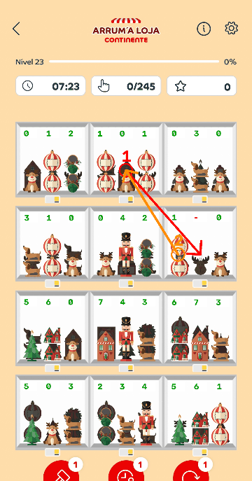
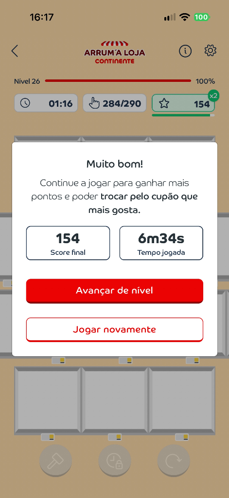

# Arrum'A Bot

Bot que joga o **Arrum'A Loja**, o jogo de arrumar prateleiras da app Cartão Continente. Vê o ecrã do
telemóvel, percebe o tabuleiro com visão por computador (sem catálogo de produtos: aprende-os enquanto joga) e
calcula com pesquisa A\* as jogadas que fazem trios gastando o mínimo de jogadas. Também joga os níveis em que as
prateleiras andam em passadeiras.

**Resultado:** passou os níveis 23 a 26 num iPhone real, incluindo o 26, em que metade das prateleiras anda em passadeiras:

| Nível | Produtos | Jogadas | Tempo | Tentativas |
|---|---|---|---|---|
| 23 · Decoração de Natal | 14 tipos, ~100 trios | **234 / 245** | **5:05** / 7:25 | 6 (as 5 primeiras serviram para afinar o bot) |
| 24 · Higiene e Beleza | 8 tipos, 143 trios | **292 / 300** | **6:24** / 8:28 | 1, mas foi preciso ajudar à mão no fim (o bot andava com o mesmo produto para trás e para a frente) |
| 25 · Molhos | produtos novos, 155 trios | **275 / 320** | **5:51** / ~10:00 | **1, 100% sozinho** (já com a memória de prateleiras esgotadas) |
| 26 · Corredor Cozinha | 13 tipos, 2 passadeiras | **284 / 290** | **6:34** / 7:39 | 5, a última 100% sozinho (ver [passadeiras](#níveis-com-passadeiras-nível-26)) |



*O bot a jogar o nível 23 ao vivo. Os números a verde são os tipos de produto reconhecidos e os `b#` são
as silhuetas da camada de trás. As setas mostram as jogadas planeadas até ao próximo trio.*

## Compatibilidade

| Computador | Telemóvel | Ligação | Estado |
|---|---|---|---|
| Mac | iPhone | [WebDriverAgent](https://github.com/appium/WebDriverAgent) (precisa do Xcode) | ✅ **testado** (níveis 23–26) |
| Windows, Mac ou Linux | Android | adb (Android Debug Bridge) | ⚠️ implementado e testado com um adb simulado, **nunca num Android real** |
| Mac (fora da UE) | iPhone | Replicação do iPhone | ⚠️ implementado, não testado (a Replicação não existe na UE) |
| Windows ou Linux | iPhone | — | ❌ não suportado: o WebDriverAgent tem de ser compilado e assinado pelo Xcode, que só existe no macOS |
| qualquer | nenhum | análise de screenshots, simuladores, benchmarks | ✅ |

## Começar

Precisas de Python 3.11+ e do jogo aberto num nível. Os guias completos, passo a passo, estão em
[docs/instalar-mac-iphone.md](docs/instalar-mac-iphone.md) e [docs/instalar-android.md](docs/instalar-android.md).

**Mac + iPhone** (Xcode instalado, conta Apple no Xcode, Modo de programador ligado no iPhone):

```bash
git clone https://github.com/Nunomatos7/arruma-bot.git && cd arruma-bot
python3 -m venv .venv && .venv/bin/pip install -r requirements.txt
.venv/bin/python -m tools.setup_wda --team O_TEU_TEAM_ID --bundle-prefix com.oteunome.arrumabot
.venv/bin/python -m bot.wda start O_TEU_TEAM_ID
.venv/bin/python -m bot.run --wda --auto --max-moves 290 --time-limit 459
.venv/bin/python -m bot.wda stop
```

**Windows + Android** (PowerShell; adb instalado e depuração USB autorizada):

```powershell
git clone https://github.com/Nunomatos7/arruma-bot.git; cd arruma-bot
py -m venv .venv; .venv\Scripts\Activate.ps1; pip install -r requirements.txt
python -m bot.android shot
python -m bot.run --android                    # assistente: mostra as setas, tu jogas
python -m bot.run --android --auto --max-moves 245
```

(macOS/Linux + Android: igual, com `python3 -m venv .venv && source .venv/bin/activate`.)

Sem `--auto` o bot fica em **modo assistente**: abre uma janela com as setas da próxima jogada e tu jogas.
`--max-moves` são as jogadas do nível e `--time-limit` o tempo em segundos (só conta nos níveis com passadeiras).

## Documentação

| Documento | Para quê |
|---|---|
| [docs/instalar-mac-iphone.md](docs/instalar-mac-iphone.md) | Instalação completa no Mac com iPhone: Xcode, conta Apple, WebDriverAgent, primeira execução |
| [docs/instalar-android.md](docs/instalar-android.md) | Instalação em Windows/macOS/Linux com Android: Python, adb, depuração USB, calibração |
| [docs/como-funciona.md](docs/como-funciona.md) | Arquitetura, visão, solver, modo passadeiras e todos os parâmetros |
| [docs/problemas.md](docs/problemas.md) | Problemas comuns e soluções, por sintoma |
| [docs/desenvolvimento.md](docs/desenvolvimento.md) | Testar sem telemóvel, registos de cada jogo, simuladores, níveis e dispositivos novos |

## O jogo

- 12 prateleiras, cada uma com 3 posições à frente e várias camadas atrás.
- Uma jogada consiste em **tocar num produto** (fica selecionado) e depois **tocar numa posição vazia** de outra prateleira.
- 3 produtos iguais na mesma prateleira desaparecem.
- Quando a frente de uma prateleira fica vazia, avança a camada de trás, da qual só se vê a silhueta.
  Uma prateleira que fica vazia de vez já não tem mais camadas.
- O nível 23 tem **245 jogadas** e **7:25** para cerca de 100 trios. O tabuleiro muda em cada tentativa.
  Na primeira metade do nível há em média **só 1 posição livre**. Por isso jogar "à vista" gasta jogadas a mais.
- Power-ups (1 de cada): o **martelo** faz um trio sem gastar jogadas, o **relógio** congela o tempo 10 s
  e as **setas** baralham os produtos.

## Como funciona

```
telemóvel ──(iPhone: WebDriverAgent · Android: adb)──► screenshot ──► visão ──► estado ──► solver (A*) ──► toques
    ▲                                                                                                      │
    └───────────────────── espera o ecrã parar (ou, nas passadeiras, prevê onde as prateleiras vão estar) ◄─┘
```

| Módulo | O que faz |
|---|---|
| [bot/wda.py](bot/wda.py) | Ponte para o iPhone via **WebDriverAgent** (XCUITest): stream MJPEG para ver o ecrã a 15 fps, ações W3C para tocar e arranque automático com `xcodebuild` |
| [bot/android.py](bot/android.py) | Ponte para Android via **adb**: screenshots crus e toques `input tap` |
| [bot/board.py](bot/board.py) | Deteta as 12 prateleiras (componentes ligados das zonas brancas) e divide cada uma em 3 posições |
| [bot/vision.py](bot/vision.py) | Reconhece os produtos **sem catálogo pré-definido**: aprende os tipos à medida que aparecem, por template matching com máscara numa escala canónica. Identifica as silhuetas da camada de trás por forma (IoU) |
| [bot/solver.py](bot/solver.py) | Pesquisa **A\*** pelo trio mais próximo, com heurística admissível (produtos em falta + intrusos a retirar) e estados como multiconjuntos para cortar simetrias. Modela de forma pessimista o que ainda não se vê. Entre os caminhos mais curtos, escolhe o que deixa mais pares e mais espaço livre |
| [bot/conveyor.py](bot/conveyor.py) | Níveis com **passadeiras**: segue cada prateleira em movimento, lembra-se do que tem, toca onde ela vai estar e decide quando vale a pena esperar |
| [bot/game.py](bot/game.py) | Regras do jogo e simulador, para testar o solver sem o telemóvel |
| [bot/run.py](bot/run.py) | Linha de comandos e ciclo ao vivo: modo automático ou assistente, martelo, registos em `runs/` |
| [bot/powerups.py](bot/powerups.py) | Encontra os botões do martelo, relógio e baralhar no ecrã |

Explicação detalhada em [docs/como-funciona.md](docs/como-funciona.md).

### Decisões que valem a pena explicar

- **Tipos aprendidos, não rotulados.** Cada nível (e cada tentativa) tem produtos diferentes. Produtos iguais
  são o mesmo sprite, por isso o primeiro de cada tipo passa a protótipo e os seguintes comparam-se com ele
  por template matching com deslocamento.
- **Comparação ancorada em baixo.** Os produtos estão assentes na prateleira. O que "suja" um recorte é a silhueta
  da camada de trás, que fica por cima. Por isso compara-se só a parte de baixo, com a altura do mais baixo
  dos dois, e usa-se uma média aparada (ignora os 20% piores píxeis).
- **"Há produto aqui?" decide-se pela cor viva.** As silhuetas de trás têm reflexos cinzentos claros e o chão da
  prateleira também é cinzento. Só os produtos da frente têm píxeis saturados e brilhantes.
- **Escala canónica.** Tudo é reamostrado para prateleiras de 150 px. A mesma visão funciona na gravação de ecrã
  e no stream do WebDriverAgent.
- **Informação parcial.** O solver só planeia até ao próximo trio ou à próxima revelação de camada. Depois disso o tabuleiro
  muda de formas imprevisíveis, por isso volta a ler o ecrã e a planear.
- **Prateleiras esgotadas, com memória.** Uma prateleira com a frente toda vazia já não tem camadas. A primeira
  versão decidia isso só pelo que via em cada leitura. Ao tirar o último produto de uma prateleira esgotada, achava
  que ia revelar algo, e na leitura seguinte devolvia-o, andando com o mesmo produto para trás e para a frente.
  Agora as prateleiras que alguma vez se viram vazias ficam marcadas, e só se escava onde há uma silhueta atrás
  (prova de que existe outra camada). No nível 24 houve 7 vaivéns do mesmo produto; no 25, depois da correção, 0.
  No simulador, as jogadas por trio desceram de 2,27 para 2,16.
- **Trios a desaparecer.** Se uma leitura apanha 3 produtos iguais ainda na prateleira (animação), o bot espera
  em vez de "planear" jogadas para os juntar.

### Níveis com passadeiras (nível 26)

No nível 26, as linhas 2 e 3 são passadeiras: andam em sentidos opostos a velocidade constante (~119 px/s),
têm **6 prateleiras cada** (a volta mede 2070 px e dura ~17 s) e só ~3 cabem no ecrã. Dados medidos com
[tools/belts.py](tools/belts.py), por correlação de fase entre frames e autocorrelação do "panorama" de cada passadeira.
O modo [bot/conveyor.py](bot/conveyor.py) é ativado sozinho quando o bot deteta linhas em movimento:

- lê o tabuleiro esperando só que as linhas *paradas* estabilizem, e ignora frames com a animação de trio
  (um círculo verde que passa por cima das prateleiras);
- planeia só com prateleiras inteiras no ecrã que lá vão continuar durante a jogada;
- toca onde a prateleira **vai estar** (posição lida + velocidade × atraso do stream e do toque), com as jogadas
  de cada sequência numa só cadeia de toques (cada pedido ao WebDriverAgent custa ~0,4 s fixos);
- **segue cada prateleira das passadeiras** no referencial da passadeira (u = x − v·t, módulo 6 prateleiras) e
  lembra-se do que lá está quando sai do ecrã. A velocidade medida no arranque tem ~10% de erro e é corrigida
  continuamente com o desvio das posições observadas;
- **espera só quando sabe que compensa**: para vários instantes futuros calcula o trio mais barato com as
  prateleiras que vão estar à vista e escolhe o que minimiza jogadas + λ × segundos, com λ dado pela folga de
  tempo (tempo restante − jogadas restantes × tempo por jogada);
- usa o relógio (congela 10 s) quando a folga acaba.

O que as tentativas ensinaram:

| Tentativa | Resultado | O que se aprendeu |
|---|---|---|
| 1 | falhou cedo | embalagens de cartão parecidas eram lidas como iguais → verificação de textura (correlação normalizada) |
| 2 | 93%, sem jogadas | os trios saíam caros → espera adaptativa |
| 3 | 88%, sem tempo nem jogadas | a espera "às cegas" gastou ~95 s para poupar ~19 jogadas. Pior: a visão partia produtos iguais em dois tipos (22 tipos para 13 produtos), por isso o bot não via pares que tinha à frente |
| 4 | 97% (com ajuda manual no fim) | sozinho ia em 87% com 247 jogadas, contra 81% na 3.ª. As animações de trio criavam tipos de lixo e estragavam a memória das passadeiras |
| **5** | **100% em 6:34, 284/290 jogadas ✅** | animações ignoradas e memória robusta: a memória das passadeiras bateu certo em 95% das revisitas (686 iguais, 37 diferentes), contra 88% na 4.ª |



As duas causas de produtos partidos em dois tipos:
- **produto encostado à borda da posição:** o protótipo, um pouco mais largo, não cabia para alinhar. A comparação
  passou a ser feita com uma margem à volta da região;
- **silhueta escura colada ao produto:** a camada de trás aparecia por cima e tornava o produto "mais alto".
  O topo do objeto é cortado enquanto as linhas forem quase só píxeis escuros e sem cor (silhueta).

Verificado com os frames de todos os níveis: no 26 passou de 22 para 13 tipos, e nos 23–25 nenhum produto foi
partido (só se juntaram duplicados). Na memória das passadeiras, uma prateleira só conta como esgotada se se vir vazia
em duas leituras, e tipos novos e raros a meio do jogo são tratados como desconhecidos.

Também experimentei (no simulador, [tools/conveyor_sim.py](tools/conveyor_sim.py)) um plano global com o tabuleiro
inteiro, para juntar produtos de várias prateleiras da passadeira ao longo do tempo, e a antecipação de 2 trios.
Nenhum foi melhor (520 e 525 trios contra 536 em 5 níveis), por isso ficaram desligados.

## Resultados

### No iPhone (nível 23)

| Tentativa | O que mudou | Resultado |
|---|---|---|
| 1 | Arrastos (o jogo só aceita toques) | 0 jogadas registadas |
| 2 | Toques + visão corrigida (começou a meio, com 2:50 no relógio) | 32 trios em 83 jogadas |
| 3 | Tentativa completa | 97%: acabaram as 245 jogadas |
| 4 | + prateleiras esgotadas | 98%: 244/245 jogadas, faltaram 2 trios |
| 5 | + martelo, mas um falso alarme de "jogada sem efeito" atrasava os toques | 97%: acabou o tempo (239/245 jogadas) |
| **6** | **+ deteção de "sem efeito" corrigida** | **100% em 5:05, 234/245 jogadas ✅** |

### No simulador

Níveis aleatórios do tamanho do nível 23: 12 prateleiras, 12 tipos, 96 trios e 2 posições vazias no início.
As duas primeiras linhas foram medidas com uma versão anterior do gerador, que às vezes criava níveis impossíveis.

| Solver | Resolvidos | Jogadas por trio | Máximo de jogadas |
|---|---|---|---|
| Guloso (custo por trio) | 72% | 2,13 | 229 |
| A\* (trio mais próximo) | 84% | 2,38 | 255 |
| **A\* + desempate pelo estado final** | **100%** (100/100) | **2,14** | **224 (< 245)** |

Também experimentei antecipar 2 trios (escolher o caminho que deixa o trio seguinte mais barato). Em Python
custava 1 a 3 s por jogada, o que não cabe nos 7:25, e ficou desligada (`LOOKAHEAD` em `bot/solver.py`).

Para correr o benchmark: `python -m tools.bench 100`. Mais ferramentas em [docs/desenvolvimento.md](docs/desenvolvimento.md).

## Aviso

Projeto pessoal e educativo, sem ligação ao Continente. O jogo dá pontos trocáveis por cupões, e jogar com
automação pode ir contra as regras da campanha: usa por tua conta e risco.

O [WebDriverAgent](https://github.com/appium/WebDriverAgent) (projeto Appium, licença BSD) não está incluído neste
repositório: o `tools/setup_wda.py` descarrega-o do repositório oficial e prepara-o com a tua conta Apple.
